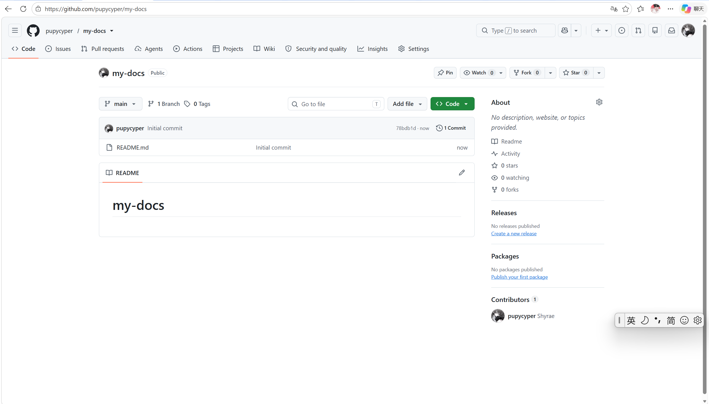
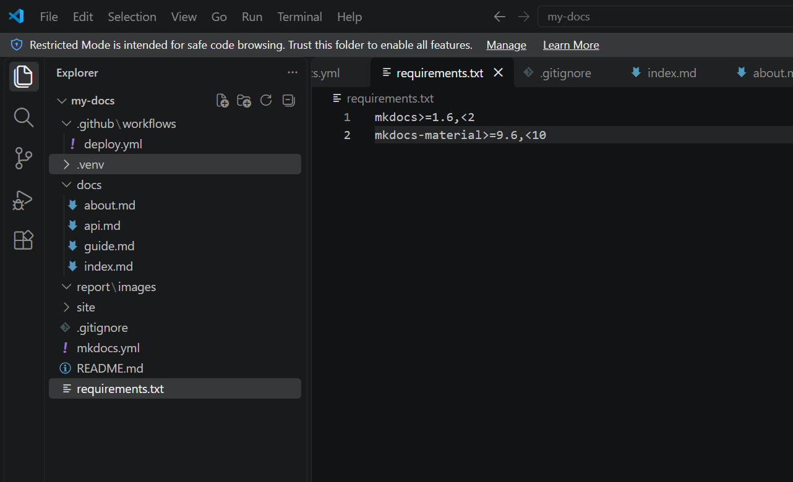
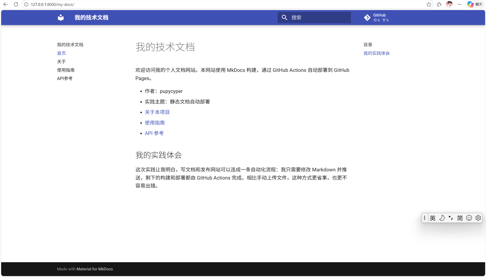
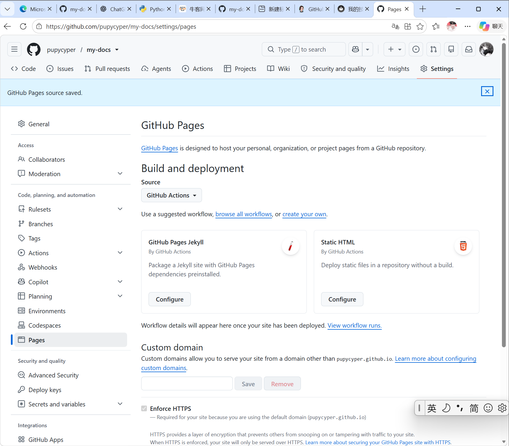
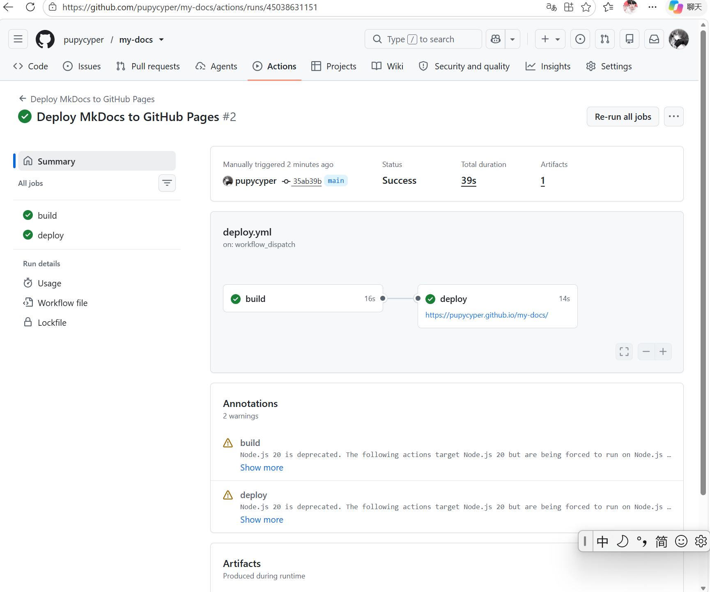
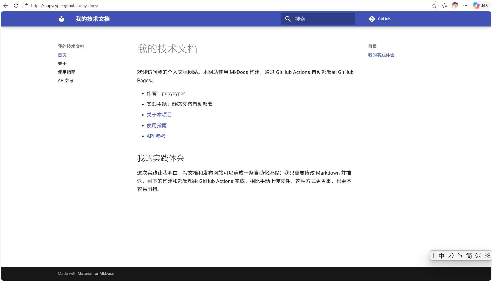
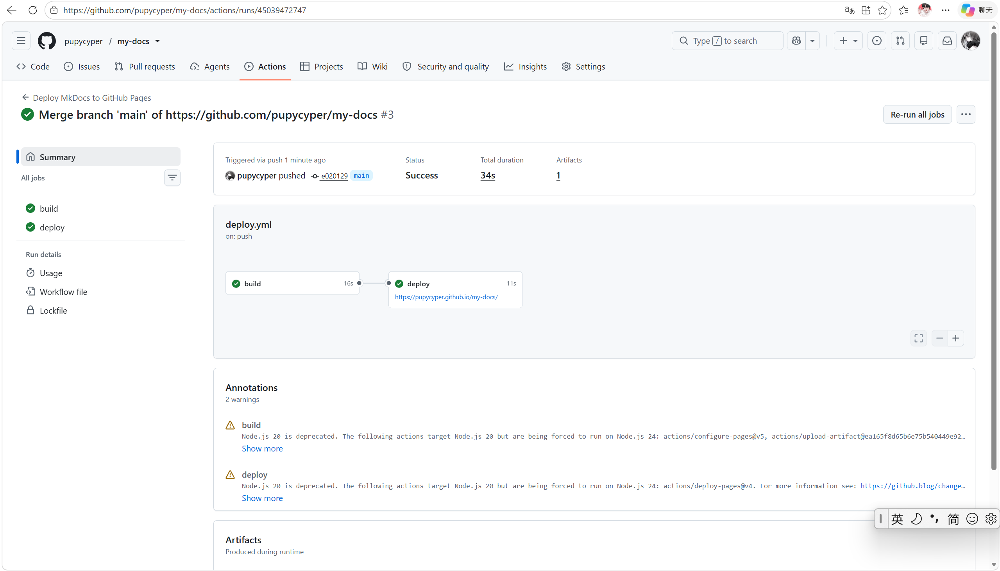
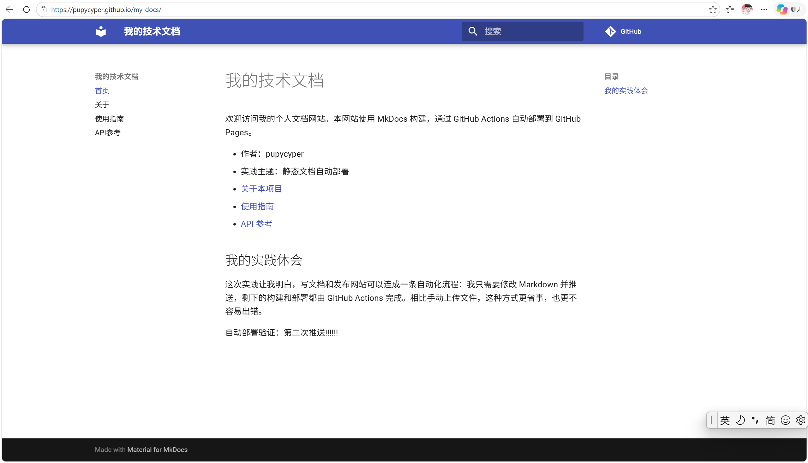

# 实践项目 2：个人实验报告

## 1. 基本信息
- GitHub 登录名：pupycyper
- 个人仓库地址：https://github.com/pupycyper/my-docs
- 最终网站地址：https://pupycyper.github.io/my-docs/

## 2. 实践过程与关键截图

### 2.1 仓库创建
我用自己的账号创建了公开仓库 my-docs，默认分支为 main。

### 2.2 项目结构与 MkDocs 配置
docs/ 存放四个网页的 Markdown 源文件；mkdocs.yml 中的 nav 决定导航栏的页面和顺序，路径相对于 docs/；site/ 是 mkdocs 构建时自动生成的网站，已写入 .gitignore，不提交。

### 2.3 本地构建与预览
用 python -m mkdocs build --strict 构建，再用 mkdocs serve 本地预览，检查了四个页面的导航、表格、代码块和页内链接。预览地址是 127.0.0.1:8000，不是公开网站。

### 2.4 Pages 设置
在 Settings → Pages 中，把 Source 设置为 GitHub Actions，页面提示 source saved。

### 2.5 Actions 首次构建和部署
设置 Pages 来源后，在 Actions 页面手动运行工作流，运行 #2 的 build 和 deploy 均成功
- 运行链接：https://github.com/pupycyper/my-docs/actions/runs/45038631151

### 2.6 网站访问与四页导航检查
网站地址为 https://pupycyper.github.io/my-docs/ 。导航均可跳转，表格、代码块显示正常，页面间链接可点

### 2.7 第二次推送与自动更新验证
我在 docs/index.md 末尾增加了“自动部署验证：第二次推送!!!!!!”，这次 push 自动触发了运行 #3，没手动点击运行，build和deploy均成功，刷新网站后新增文字已出现。
- 对应提交链接：https://github.com/pupycyper/my-docs/commit/e020129 （合并提交，包含内容改动提交 [94504f8](https://github.com/pupycyper/my-docs/commit/94504f8)）
- 对应 Actions 运行链接：https://github.com/pupycyper/my-docs/actions/runs/45039472747

## 3. 问题与解决
**现象**：第一次推送代码Actions 运行 #1 失败，build 任务红叉，deploy 被跳过。

**关键日志**：`HttpError: Not Found`，`Get Pages site failed. Please verify that the repository has Pages enabled and configured to build using GitHub Actions`。

**原因**：先推送了代码，后设置 Pages，推送时仓库还没有启用 Pages，所以该步读取不到 Pages 站点。

**解决**：在 Settings → Pages 把 Source 设为 GitHub Actions，然后在 Actions 页面手动运行工作流，运行 #2 成功。
 失败运行链接：https://github.com/pupycyper/my-docs/actions/runs/45038374971

## 4. 原理理解

### 1. docs/ 和 site/ 各保存什么？为什么不用手工修改 site/？

docs/ 放的是自己写的 Markdown 源文件，site/ 是 mkdocs build 生成出来的网页文件。site/ 不用手工改是因为每次重新构建都会把它整个覆盖掉。而且它写在 .gitignore 里，本来就不提交，线上的网站是 Actions 自己构建出来的。

### 2. 本次工作流在什么情况下自动运行？

1.往 main 分支 push，并且这次改动里有 docs/ 下的文件、mkdocs.yml、requirements.txt 或 deploy.yml 其中之一；
2.在 Actions 页面手动点 Run workflow（workflow_dispatch）。

### 3. build 与 deploy 两个任务有什么区别？

build 负责把网站做出来，拉取代码、装 Python 和依赖、执行 mkdocs build --strict，再把 site/ 打包上传。

deploy 负责把打好的包发布到 GitHub Pages，需要 pages: write 和 id-token: write 权限。deploy 里写了 needs: build，所以只有 build 成功了才会执行。

### 4. 只修改 report/README.md 会触发部署吗？为什么？

不会。工作流的 paths 里只列了 docs/**、mkdocs.yml、requirements.txt 和 deploy.yml，report/README.md 不在里面。

### 5. 本次方案为何无需创建 gh-pages 分支？

因为这次用的是官方 Pages Actions：upload-pages-artifact 把 site/ 打包成 artifact，deploy-pages 直接把这个 artifact 发布出去，构建结果不用提交到任何分支。
